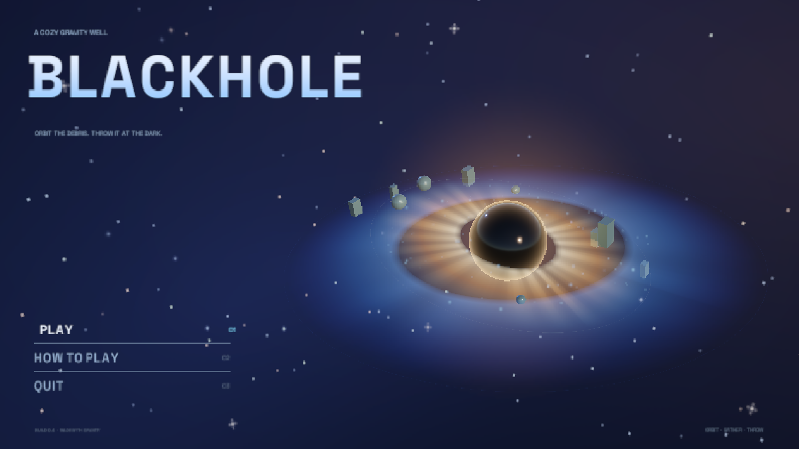
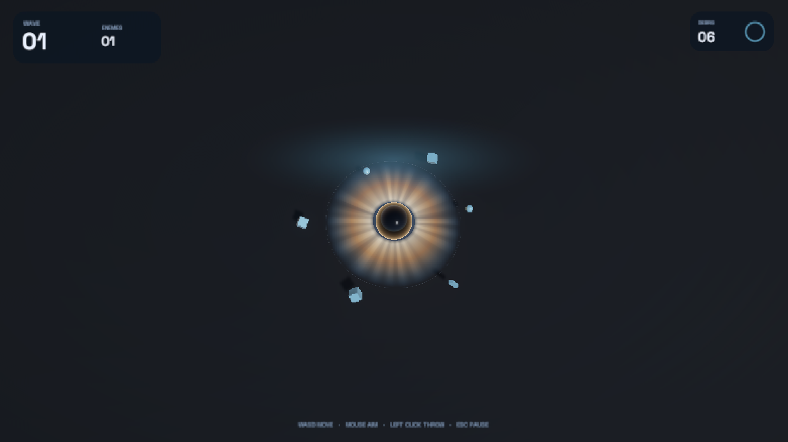
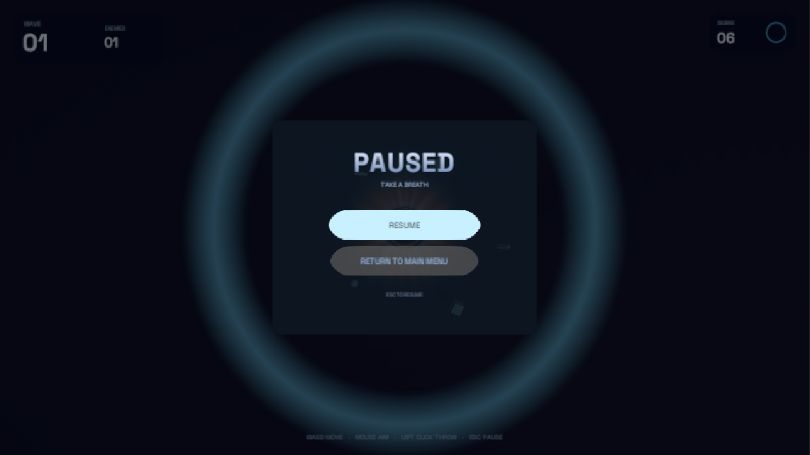

# Blackhole

A cozy little space arcade. You are a black hole: gather debris into orbit, then
hurl it at the dark before the swarm reaches you.

## Play

- **Download (Windows):** [Blackhole v1.0 release](https://github.com/HasanFarman/Blackhole/releases/tag/v1.0.0)
- **Direct build:** [`Release/Blackhole-Windows.zip`](Release/Blackhole-Windows.zip) — unzip and run `Blackhole.exe`.
- 1920x1080 fullscreen, capped at 30 FPS.

## Controls

| Input | Action |
| --- | --- |
| `WASD` | Drift around the field |
| Mouse | Aim the throw |
| Left click | Hurl a piece of orbiting debris |
| `Esc` | Pause / resume |
| `R` | Restart after the run ends |

## What's in it

- Live main menu: a drifting black hole with an accretion disc, orbiting debris
  and dust, which leans toward your mouse. Everything fades in on load.
- Endless waves of wobbling enemies that seek, lunge and break apart into sparks.
- Debris physics: capture, orbit, throw, recapture.
- Cozy UI theme: Space Grotesk, warm amber + cool cyan, soft bloom and vignette.
- Pause and game-over cards with return to main menu.

## Screenshots

| Menu | Gameplay |
| --- | --- |
|  |  |

| Pause |
| --- |
|  |

## Tech

- Unity 6.0.68f1, URP, Input System.
- The scene, materials, meshes, particle prefabs and UI are generated from
  `Assets/Editor/ProjectBootstrap.cs` — **Blackhole → Rebuild All** regenerates
  both `Main.unity` and `MainMenu.unity`.
- Tests live in `Assets/Tests` (EditMode + PlayMode).

## Font

Space Grotesk, SIL Open Font License (`Assets/Resources/Fonts/OFL.txt`).
